<!-- animated contribution graph: real data, boxes reveal cell by cell
     (regenerated daily by .github/workflows/update-profile-art.yml) -->

<h3><code>abhishek@github ~ $ ./contributions.sh</code></h3>

 
 

<!-- ascii portrait (left) + neofetch card (right). both svgs are
     840x880 so equal widths give equal heights.
     portrait:  python scripts/prep_photo.py <photo.png> && python scripts/make_ascii_svg.py
     neofetch:  python scripts/make_info_card.py -->

<h3><code>abhishek@github ~ $ whoami</code></h3>

<table>
<tr>
<td valign="top"></td>
<td valign="top"></td>
</tr>
</table>

 
 

<!-- streak / numbers card (regenerated daily by the same workflow) -->

<h3><code>abhishek@github ~ $ ./stats.sh</code></h3>

 
 

<h3><code>abhishek@github ~ $ cat now.txt</code></h3>

<b>Work: Limosys · Front-end (React, TypeScript, JavaScript) · Backend (Java, Rust)</b>

<b>Learning now: Rust (systems and shell) · FDE (forward-deployed engineering)</b>

<h3><code>abhishek@github ~ $ ./stack.sh</code></h3>

<h3><code>abhishek@github ~ $ ./links.sh</code></h3>

<b>Front-End Developer · DevOps Enthusiast · Lifelong Learner</b>

 

